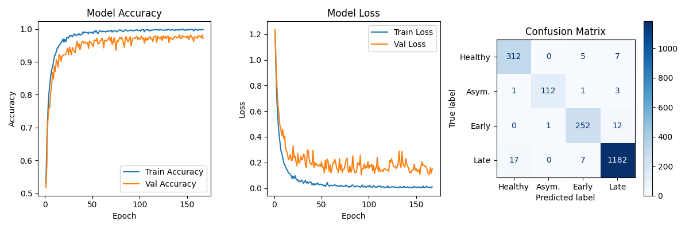

# Hyperspectral Tomato Disease Classification using DMLPFFN

This project implements a lightweight deep-learning pipeline for classifying tomato leaf disease stages using hyperspectral imaging (HSI). It is built around a Dual Multi-Layer Perceptron Feature Fusion Network (**DMLPFFN**) trained on spectral–spatial patches extracted from USDA tomato hyperspectral cubes.

## Table of Contents

- [Dataset](#dataset)
- [Features](#features)
- [Installation](#installation)
- [Usage](#usage)
- [Configuration](#configuration)
- [Model Architecture](#model-architecture)
- [Results](#results)
- [Citation](#citation)

---

## Dataset

The project uses the USDA Hyperspectral Tomato Leaf Dataset, containing hyperspectral cubes captured across multiple days after inoculation (DAI). Four refined classes are used:

- **Healthy** (0 DAI)
- **Asymptomatic** (1 DAI)
- **Early Infection** (2–3 DAI)
- **Late Infection** (4–7 DAI)

Dataset DOI:  
https://doi.org/10.15482/USDA.ADC/26046328

---

## Features

- **Complete preprocessing pipeline**
  - Water-band removal & spectral cleaning  
  - PCA harmonization to **128 components**
- **Patch extraction**
  - 9×9 spectral–spatial patches  
  - Stride = 4  
  - ~12,700 total samples
- **Stratified dataset split** (70/15/15) using group-wise split by biological unit
- **Frozen split manifest** (`artifacts/split_manifest_frozen.json`) with verified no overlap between train/val/test groups
- **DMLPFFN architecture**
  - Multi-branch *MLP-based* feature fusion (low, mid, high branches)
  - Local Perceptron with dilated operations for extended spatial perception
  - Element-wise fusion + global average pooling + classifier
- **Class imbalance handling**
  - Weighted loss  
  - Balanced sampling
- **Robust training**
  - Cosine Annealing Warm Restarts  
  - Early stopping
- **Evaluation**
  - Accuracy, Precision, Recall, F1-score
  - Confusion matrix

---

## Installation

1. Clone the repository:
```bash
git clone <repository-url>
cd dmlpffn-tomato-disease
```

2. Create a virtual environment:
```bash
python -m venv venv
venv\Scripts\activate  # Windows
# or
source venv/bin/activate  # Linux/Mac
```

3. Install dependencies:
```bash
pip install -r requirements.txt
```

---

## Usage

### Full Training
```bash
python main_experiment.py
```

The full pipeline will:

- Load and preprocess hyperspectral cubes
- Apply PCA → patch extraction → normalization
- Perform stratified dataset splitting
- Train DMLPFFN with weighted loss and balanced sampling
- Save logs, metrics, and confusion matrix
- Print the final test performance

---

## Configuration

Modify `config.py` to adjust:

| Parameter       | Description              | Default |
|-----------------|--------------------------|---------|
| data_root      | Dataset directory       | ./tomato_leaf |
| pca_components | PCA dimension           | 128     |
| patch_size     | Patch size              | 9       |
| stride         | Patch stride            | 4       |
| batch_size     | Training batch size     | 16      |
| lr             | Learning rate           | 2e-4    |
| weight_decay   | L2 regularization       | 1e-4    |
| epochs         | Number of training epochs | 250   |
| patience       | Early stopping patience | 25      |

---

## Model Architecture

DMLPFFN is a Dual Multi-Layer Perceptron Feature Fusion Network designed for spectral-spatial hyperspectral learning.

- **Input**: [N, 128, 9, 9]
- **Three feature branches**:
  - Low-branch → local feature enhancement
  - Mid-branch → mid-range spectral–spatial learning
  - High-branch → direct MLP-based spectral modeling
- **Local Perceptron Block** with dilated operations
- **Fusion**: Element-wise aggregation of all branches
- **Output**: 4-class classification (healthy → late disease)

---

## Results



- **Quick test (5 epochs)**: ~78.4% accuracy
- **Full training (250 epochs)**: Expected accuracy ≈ 0.97+, matching reported performance

---

## Citation

If you use this code, please cite:

@misc{shukla2025dmlpffn,
  title     = {DMLPFFN: Dual Multi-Layer Perceptron Feature Fusion Network for Early Detection of Tomato Bacterial Leaf Spot using Hyperspectral Imaging},
  author    = {Shukla, Ayush and Kapoor, Tanay and Yadav, Akash},
  year      = {2025},
  howpublished = {\url{https://github.com/AyushShukla73/DMLPFFN-TomatoDisease-Detection}},
  note      = {Project contributors: \url{https://github.com/AyushShukla73}, \url{https://github.com/TanayKapoor21}, \url{https://github.com/AkashYdv2}}
}


